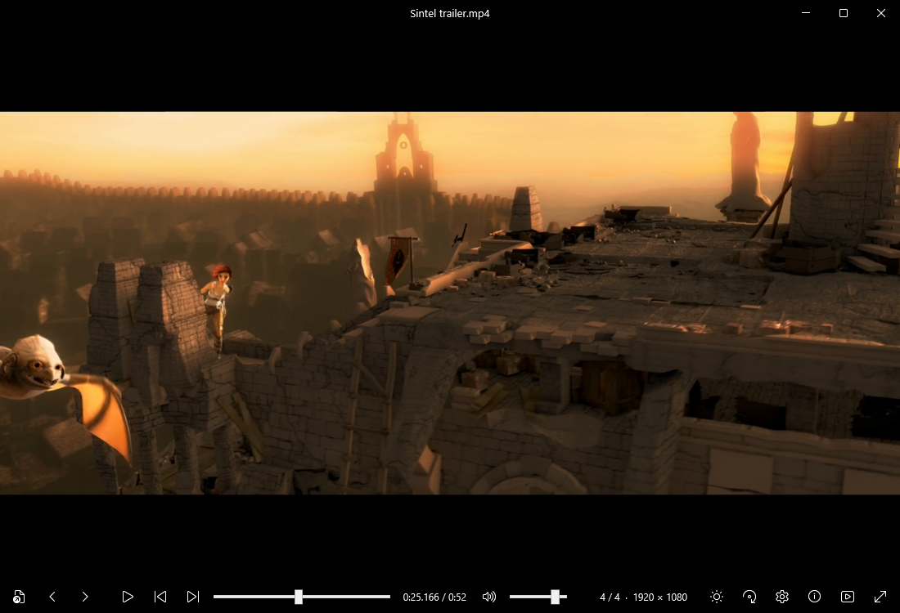

# Simple

A simple picture and video viewer for Windows, made for private use. It never connects to the internet: no telemetry, no account, no ads.

**[Download for Windows](https://github.com/SimpleAplications/simple-viewer/releases/latest/download/Simple-Setup.exe)**
 · [Portable zip](https://github.com/SimpleAplications/simple-viewer/releases/latest/download/Simple-portable.zip)
 · [Website](https://simpleaplications.github.io/simple-viewer/)



## What it does

- **Frame stepping, both ways.** Tap `X` or `Z` to move exactly one frame forward or back; hold to keep going, faster the longer you hold. Every frame is shown complete.
- **Pictures, GIFs and video in one window.** Open one file and move through the rest of the folder. Zoom, pan, rotate and flip.
- **Stays on your PC.** No network code and no history of what you open. The only file it writes is your own options (`%APPDATA%\Simple\settings.json`).
- **Picture controls.** Brightness, contrast, saturation, gamma and warmth, for display only.
- **Your keys, your colour.** Choose the keys for the main actions and the colour of the window.
- **Folder playback.** Move on when a video ends, in order or shuffled, once or on repeat; or repeat one file.

## Keys

| Action | Key |
|---|---|
| Previous / next file | `Left` / `Right`, or `C` / `V` |
| Play / pause | `Space` |
| One frame back / forward (hold to keep going) | `Z` / `X` |
| Jump 5 seconds | `Ctrl` + `Left` / `Right` |
| Zoom | mouse wheel, `+` / `-`, `0` to reset |
| Rotate right | `R` |
| Picture settings | `A` |
| Play the whole folder | `S` |
| Fullscreen | `F11`, `F` or double-click |
| Open a file | `O` |
| Formats and credits | `F1` |

`Space`, `C`, `V`, `Z` and `X` can be changed in Options.

## Building from source

You need Windows and the [.NET 10 SDK](https://dotnet.microsoft.com/download).

1. Get FFmpeg 8.1 as an LGPL **shared** build for Windows x64, for example
   `ffmpeg-n8.1-latest-win64-lgpl-shared-8.1.zip` from
   [BtbN/FFmpeg-Builds](https://github.com/BtbN/FFmpeg-Builds/releases).
2. Copy these files from its `bin` folder into `codecs`:
   `avcodec-62.dll`, `avformat-62.dll`, `avutil-60.dll`, `swresample-6.dll`, `swscale-9.dll`.
3. Build and run:

   ```
   dotnet build MediaViewer.csproj -c Release
   bin\Release\net10.0-windows\Simple.exe
   ```

`release.ps1` builds the installer (it needs [Inno Setup 6](https://jrsoftware.org/isinfo.php)) and the portable zip into `dist`.

The picture adjustments use a small pixel shader, `Adjust.fx`. Its compiled form `Adjust.ps` is checked in; to rebuild it, run `fxc /T ps_2_0 /E main /Fo Adjust.ps Adjust.fx` from the Windows SDK.

## Licence and credits

Simple's own code is under the [MIT licence](LICENSE).

Pictures and video are decoded by libraries from the [FFmpeg](https://ffmpeg.org) project, under the GNU Lesser General Public License. They are shipped with the releases as separate, unmodified DLLs, and the FFmpeg source for the shipped build is attached to each release. Details are in [THIRD-PARTY-NOTICES.txt](THIRD-PARTY-NOTICES.txt). Simple is not affiliated with or endorsed by the FFmpeg project.

The screenshots show the *Sintel* trailer, © Blender Foundation (durian.blender.org), CC BY 3.0; the Carina Nebula "Cosmic Cliffs", NASA, ESA, CSA and STScI; and Blue Marble 2012, NASA Goddard Space Flight Center.
